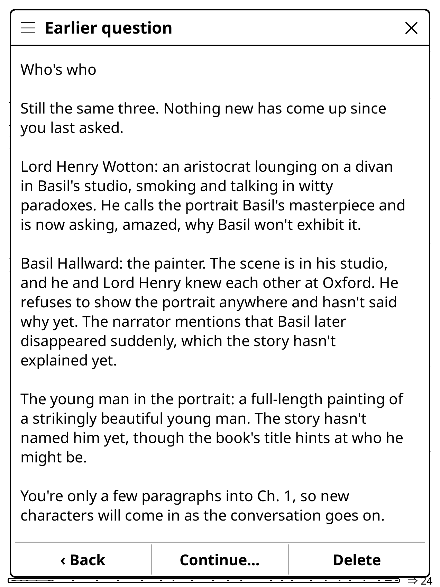

# Ask Claude for KOReader

Ask Claude Code on your computer about the book you're reading in KOReader. By default, Claude only sees the text up to your current page. What Claude does is configured by the modules in [`server/modules/`](server/modules/).

<p align="center">
  
  <br>
  <sub>Asks information about “who is each chacter” early in Chapter 1 of <i>The Picture of Dorian Gray</i>.</sub>
</p>

## Requirements

- Claude Code on the computer, and calibre for EPUB/MOBI books
- KOReader on a Kindle, with `ssh kindle` working
- A Kindle key pair: private key at `koreader/settings/SSH/id_laptop`, public key on the computer at `~/.ssh/kindle_to_laptop.pub`

Both are covered in [docs/setup.md](docs/setup.md).

## Setup

```sh
git clone https://github.com/rfvasile/kindle-askclaude.git
cd kindle-askclaude
SUBNET=192.168.1.0/24 bash setup-laptop.sh   # your home network
bash install-kindle.sh
```

Then restart KOReader, select some text and tap **Ask Claude…**. More in [docs/usage.md](docs/usage.md).
